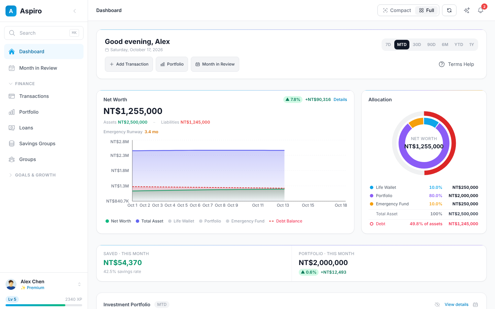
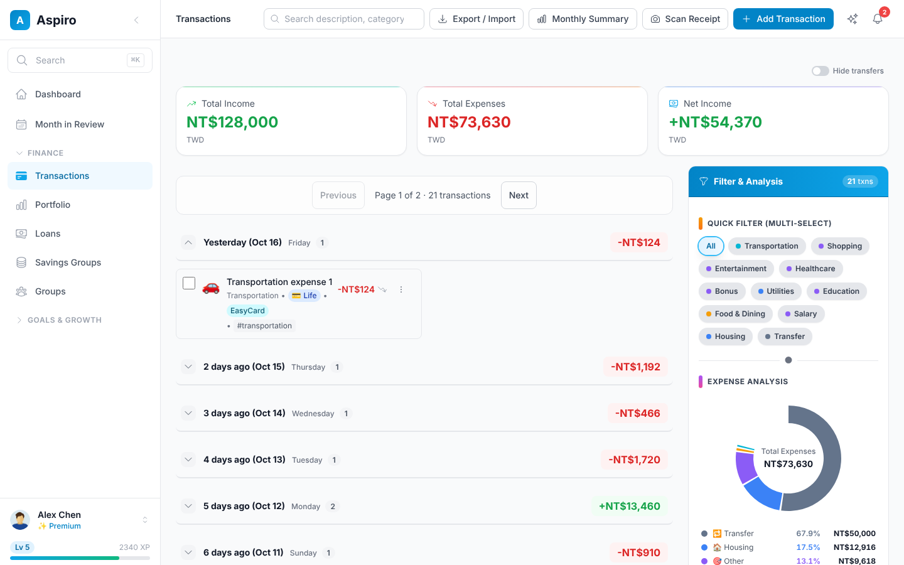
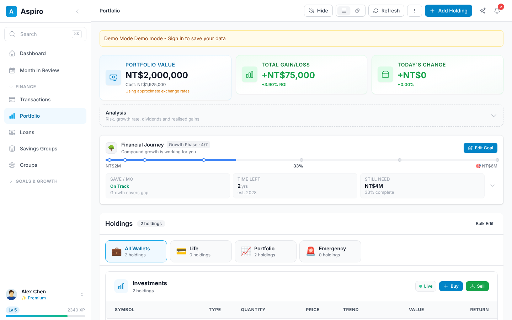
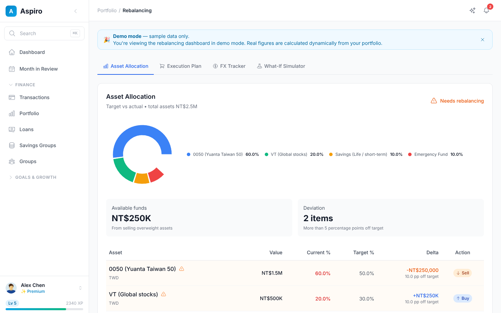
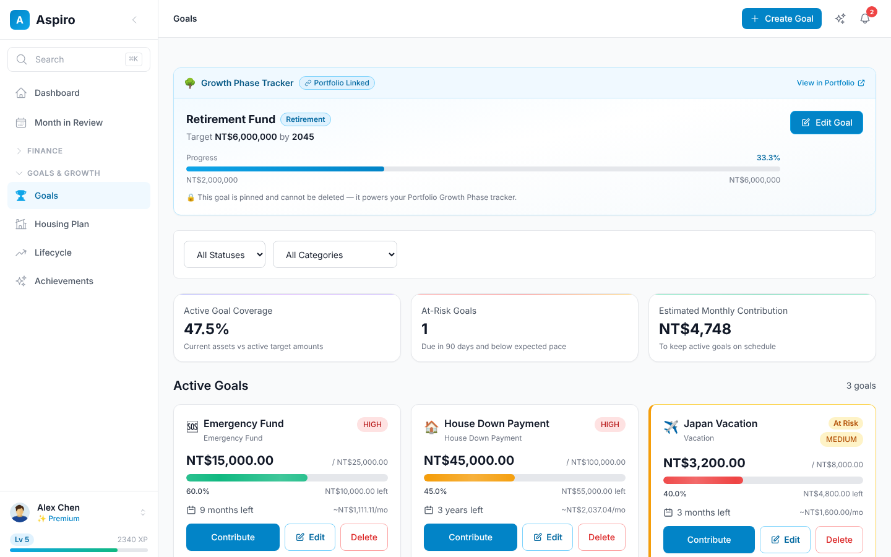
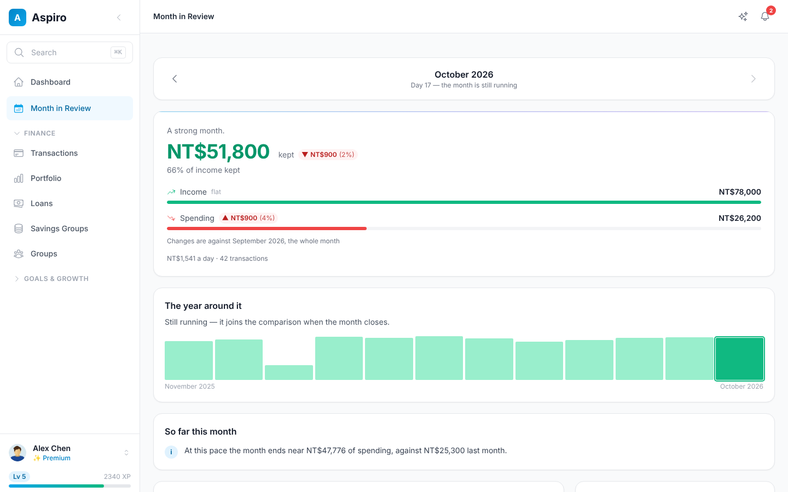

<div align="center">

# Aspiro

**Personal finance for Asian markets, self-hosted.**
Daily spending, investments, savings goals and net worth in one place, with a LINE bot for
recording expenses and splitting group bills from chat.

[](https://github.com/sc0210/Aspio/actions/workflows/ci.yml)
[](LICENSE)


[Features](#features) · [Self-host](#self-host-your-own) · [Develop](#run-it-locally) ·
[Docs](#documentation) · [Contributing](#contributing)

</div>

<table>
  <tr>
    <td width="50%"><b>Dashboard</b><br><picture><source media="(prefers-color-scheme: dark)" srcset="docs/images/screenshots/2026.09.3/dashboard-dark.png"></picture></td>
    <td width="50%"><b>Transactions</b><br><picture><source media="(prefers-color-scheme: dark)" srcset="docs/images/screenshots/2026.09.3/transactions-dark.png"></picture></td>
  </tr>
  <tr>
    <td><b>Portfolio</b><br><picture><source media="(prefers-color-scheme: dark)" srcset="docs/images/screenshots/2026.09.3/portfolio-dark.png"></picture></td>
    <td><b>Rebalancing</b><br><picture><source media="(prefers-color-scheme: dark)" srcset="docs/images/screenshots/2026.09.3/rebalancing-dark.png"></picture></td>
  </tr>
  <tr>
    <td><b>Goals</b><br><picture><source media="(prefers-color-scheme: dark)" srcset="docs/images/screenshots/2026.09.3/goals-dark.png"></picture></td>
    <td><b>Month in Review</b><br><picture><source media="(prefers-color-scheme: dark)" srcset="docs/images/screenshots/2026.09.3/review-dark.png"></picture></td>
  </tr>
</table>

<sub>Screenshots follow your GitHub theme and are taken in demo mode, on fixture data with no
account. Earlier versions are in the [screenshot history](docs/images/screenshots/README.md).</sub>

## Features

| | |
|---|---|
| **Net worth in one number** | Assets across every wallet minus debt, with trends, allocation and an emergency-runway readout |
| **Transactions** | Income and expenses, categories, filters, Life ↔ Emergency transfers, CSV import, receipt scanning with local OCR |
| **Portfolio** | Stocks, ETFs and crypto with live and historical prices, per-holding drill-down, performance and IRR |
| **Rebalancing** | Drift from your target allocation, the buy/sell quantities to fix it, fee estimates and FX timing |
| **Goals & savings** | Savings goals with milestones and streaks, shared goals with friends |
| **Month in Review** | Each month told as a story: what you kept, cash flow against last month, and what moved |
| **LINE bot** | Record an expense from chat, or split a group bill and settle it |
| **Made for the region** | TWD by default, Taiwan brokerage fee models, regional payment methods, English and 繁體中文 UI |

Every page also runs in a full **demo mode** on fixture data, so you can try the whole app
without creating an account.

### Three wallets

Everything is organised around three wallets, so money is never counted twice:

| Wallet | Holds |
|---|---|
| **Life** | Day-to-day cash: income and expenses |
| **Emergency** | The emergency fund |
| **Portfolio** | Stocks, ETFs and crypto, never cash |

Buying a holding debits Life and selling credits it back. Details are in
[docs/FINANCIAL_TERMINOLOGY.md](docs/FINANCIAL_TERMINOLOGY.md).

## Self-host your own

Aspiro has no hosted service and no published images: you clone the repo and build your own
instance. It runs on any 64-bit Linux or macOS host, Raspberry Pi 4/5 included, and can be
reached from outside through a Cloudflare Tunnel without opening a router port.

```bash
git clone https://github.com/sc0210/Aspio.git /opt/aspiro && cd /opt/aspiro
scripts/aspiro setup            # asks for your domain and Google OAuth client, writes .env
scripts/aspiro update --init    # first install: builds, initialises the database, starts
scripts/aspiro status
```

Later, `scripts/aspiro update` pulls, rebuilds and restarts, and rolls back if the database
migration doesn't land. [docs/SELF_HOSTING.md](docs/SELF_HOSTING.md) covers the Cloudflare
Tunnel, Google sign-in, running without Docker, backups, rollback and a security checklist.

## Run it locally

For development. You need Docker, Node 22 and Python 3.11.

```bash
cp .env.sample .env
cp backend/.env.sample backend/.env
cp frontend/.env.sample frontend/.env.local
./start-local.sh
```

| Service | URL |
|---|---|
| Frontend | http://localhost:3000 |
| API | http://localhost:8000 (reference at `/docs`) |
| pgAdmin | http://localhost:5050 |

To look around without signing in, set a `demo-mode=true` cookie on `localhost:3000`.

```bash
cd backend && python -m pytest                    # backend tests
cd frontend && npm test                           # frontend unit tests
cd frontend && npm run lint && npm run type-check
```

[DEVELOPMENT_GUIDE.md](DEVELOPMENT_GUIDE.md) covers the day-to-day workflow and the
environment traps worth knowing about.

### Stack

| Layer | Built with |
|---|---|
| Frontend | Next.js 16 (App Router) · React 19 · TypeScript · Tailwind CSS · TanStack Query · NextAuth · Recharts |
| Backend | FastAPI · SQLAlchemy 2 (async) · Pydantic v2 · Alembic |
| Data | PostgreSQL 15 |
| Self-host | Docker Compose · Caddy · Cloudflare Tunnel |

Exact versions are in `frontend/package.json` and `backend/requirements.txt`.

### Repository layout

```
backend/     FastAPI app: one module per domain under app/modules/, Alembic migrations, tests
frontend/    Next.js app: routes in src/app/, hooks and services per domain, Jest and Playwright tests
docs/        Architecture, conventions, self-hosting, screenshots
scripts/     The `aspiro` self-host CLI, backup and restore
caddy/       Reverse proxy config for the production stack
```

## Documentation

| If you want to… | Read |
|---|---|
| See everything the app does | [docs/PRODUCT_OVERVIEW.md](docs/PRODUCT_OVERVIEW.md) |
| Run your own instance | [docs/SELF_HOSTING.md](docs/SELF_HOSTING.md) |
| Understand how it is built | [docs/ARCHITECTURE.md](docs/ARCHITECTURE.md) |
| Change anything that touches money | [docs/FINANCIAL_TERMINOLOGY.md](docs/FINANCIAL_TERMINOLOGY.md) |
| Write UI | [docs/UI_CONVENTIONS.md](docs/UI_CONVENTIONS.md) |
| Run or write tests | [docs/TESTING.md](docs/TESTING.md) |
| Touch auth, middleware or the schema | [docs/SECURITY.md](docs/SECURITY.md) |

The full index is [docs/README.md](docs/README.md).

## Contributing

Issues and pull requests are welcome. [CONTRIBUTING.md](CONTRIBUTING.md) covers setup, the checks
CI runs, and how to send a change; for anything bigger than a fix, open an issue first.

Report security problems privately through
[GitHub's advisory form](https://github.com/sc0210/Aspio/security/advisories/new), not in an
issue. See [SECURITY.md](SECURITY.md).

## License

[Apache License 2.0](LICENSE).
