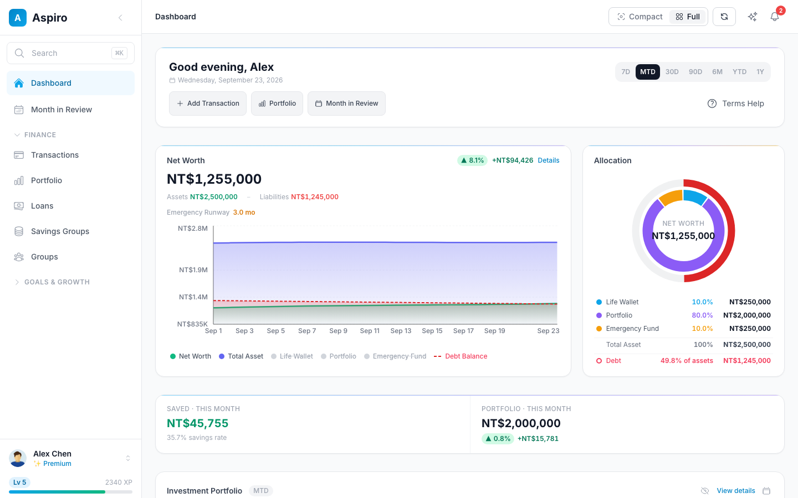
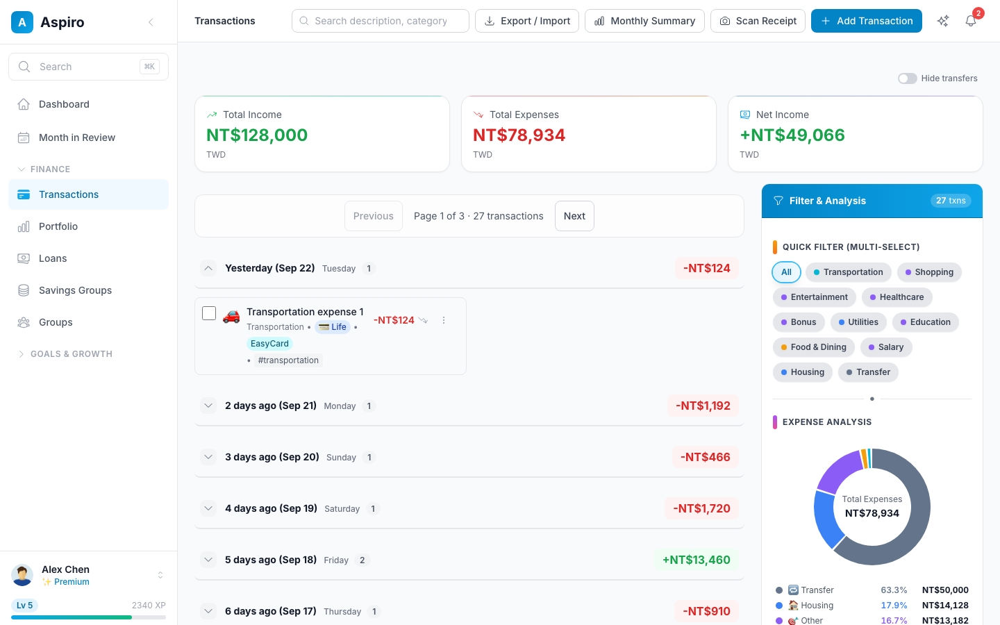
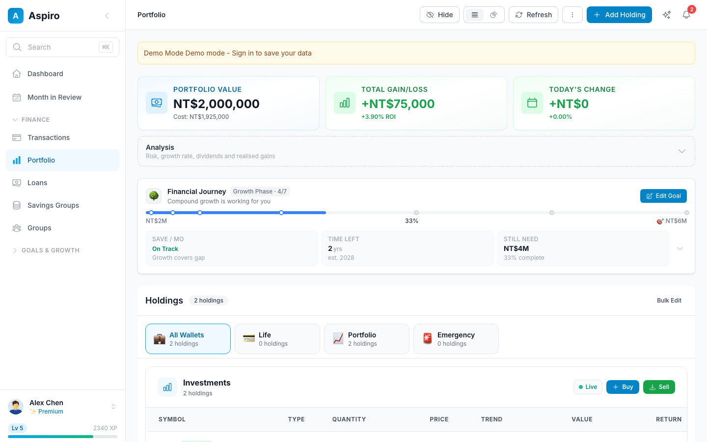
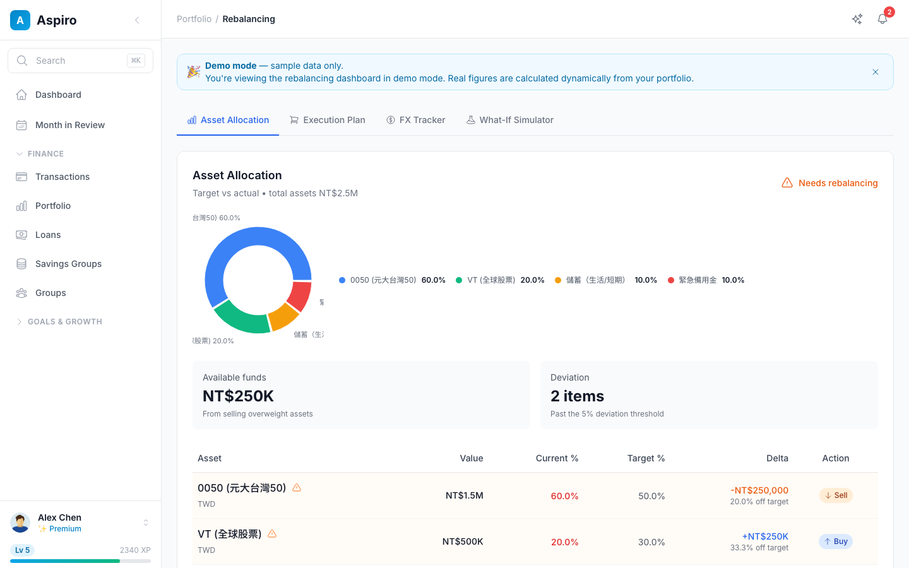
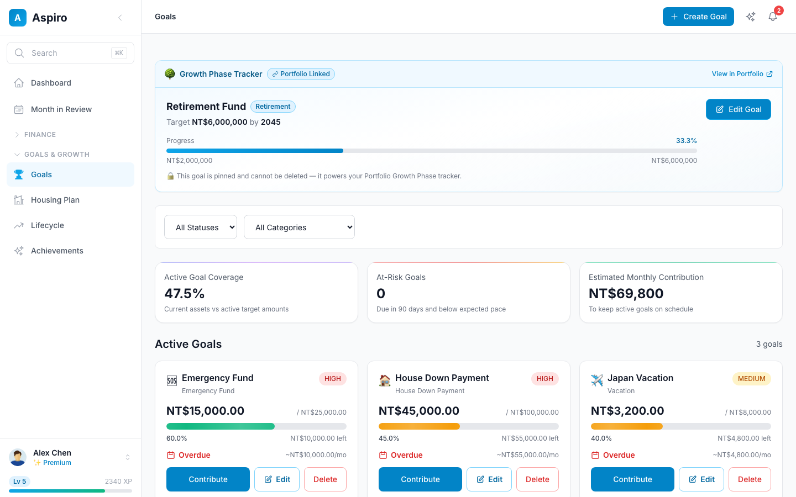
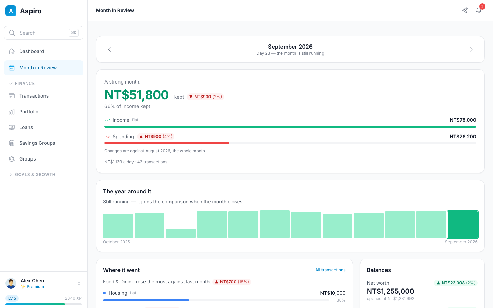

# Aspiro

A personal finance app for Asian markets: daily expenses, investment portfolios, savings goals,
and a LINE bot for recording spending and splitting group bills from chat.

<table>
  <tr>
    <td width="50%"><b>Dashboard</b><br></td>
    <td width="50%"><b>Transactions</b><br></td>
  </tr>
  <tr>
    <td><b>Portfolio</b><br></td>
    <td><b>Rebalancing</b><br></td>
  </tr>
  <tr>
    <td><b>Goals</b><br></td>
    <td><b>Month in Review</b><br></td>
  </tr>
</table>

Screenshots use demo mode, which runs on fixture data with no account. Older versions are in the
[screenshot history](docs/images/screenshots/README.md).

## Stack

Next.js 16 · React 19 · TanStack Query · NextAuth — FastAPI · SQLAlchemy 2 (async) · Alembic —
PostgreSQL 15. Exact versions are in `frontend/package.json` and `backend/requirements.txt`.

## Three wallets

| Wallet | Holds |
|---|---|
| **Life** | Day-to-day cash: income and expenses |
| **Emergency** | The emergency fund |
| **Portfolio** | Stocks, ETFs, crypto — never cash |

Buying a holding debits Life; selling credits it back, so nothing is counted twice. Details in
[docs/FINANCIAL_TERMINOLOGY.md](docs/FINANCIAL_TERMINOLOGY.md).

## Run it locally

Needs Docker, Node 22 and Python 3.11.

```bash
cp .env.sample .env
cp backend/.env.sample backend/.env
cp frontend/.env.sample frontend/.env.local
./start-local.sh
```

Frontend on http://localhost:3000, API on http://localhost:8000 (reference at `/docs`).

```bash
cd backend && python -m pytest     # backend tests
cd frontend && npm test             # frontend tests
```

To run your own instance, clone this repo and build it on your machine (with or without
Docker): see [docs/SELF_HOSTING.md](docs/SELF_HOSTING.md).

## Docs

Start at [docs/README.md](docs/README.md).

## Contributing

Issues and pull requests are welcome. [CONTRIBUTING.md](CONTRIBUTING.md) covers setup, the checks
CI runs, and how to send a change. Report security problems privately through
[GitHub's advisory form](https://github.com/sc0210/Aspio/security/advisories/new), not in an issue.

## License

[Apache License 2.0](LICENSE).
